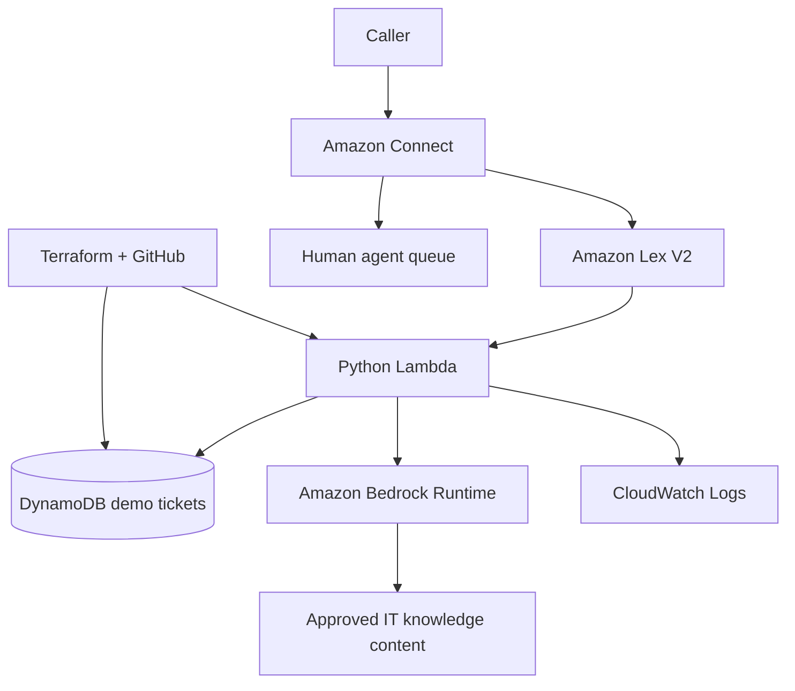

# AWS AI IT Service Desk Assistant

Portfolio project: Amazon Connect + Amazon Lex V2 + Python AWS Lambda + Amazon Bedrock + DynamoDB + Terraform.

## What it does
- Answers common VPN, Outlook, account-access, and software-installation questions.
- Creates synthetic demo tickets in DynamoDB.
- Looks up demo ticket status.
- Optionally calls Amazon Bedrock for natural-language IT guidance.
- Includes local unit tests and a Terraform starter.

This is a learning scaffold, not a production-ready service. It does not authenticate callers and must use synthetic data until security controls are implemented.

## Architecture



Bedrock currently uses the Converse API with a constrained prompt. For answers grounded in your own runbooks, add a Bedrock Knowledge Base and implement retrieval-augmented generation.

## Prerequisites
- AWS CLI v2 and credentials configured.
- Python 3.12 and Terraform 1.6+.
- One AWS Region where your chosen services and Bedrock model are available.
- For voice testing, an Amazon Connect instance and a test phone number (optional; charges may apply).
- Bedrock model access/permissions as required by your account and Region.

## Local tests

```powershell
python -m venv .venv
.\.venv\Scripts\Activate.ps1
python -m pip install -r requirements-dev.txt
python -m unittest discover -s tests -v
```

## Console-first order
1. Create DynamoDB table `itsm-demo-tickets`, partition key `ticket_id` (String).
2. Create Python Lambda `itsm-lex-handler`, handler `app.lambda_handler`, and upload the contents of `lambda/`.
3. Set environment variables `TICKET_TABLE=itsm-demo-tickets`, `BEDROCK_ENABLED=false`.
4. Add least-privilege permissions for DynamoDB `PutItem`/`GetItem`; add Bedrock permissions only when enabling it.
5. Create the Lex V2 bot and intents described in `docs/lex-intents.md`; associate the Lambda with the bot alias and enable fulfillment hooks.
6. Build and test Lex.
7. Create/configure Connect, add the Lex V2 bot, and build the contact flow in `docs/connect-flow.md`.
8. Test agent transfer and failure branches.
9. Enable Bedrock only after selecting a model available in the chosen Region.
10. Recreate the DynamoDB/Lambda baseline with Terraform.

## Terraform starter

From repository root, package the Lambda source:

```powershell
Compress-Archive -Path .\lambda\* -DestinationPath .\terraform\lambda.zip -Force
cd terraform
Copy-Item terraform.tfvars.example terraform.tfvars
# Edit terraform.tfvars
terraform init
terraform fmt -check
terraform validate
terraform plan
terraform apply
```

The Terraform starter provisions DynamoDB, the Lambda role/policy, log group, and function. Lex bot versions/aliases and Connect contact flows are intentionally configured in the console first because these integrations are account-, Region-, and configuration-specific. Add Terraform resources incrementally after the manual path works. Never commit `terraform.tfvars`, ZIP artifacts, credentials, or state files.

## Important limitations
- Ticket creation is a demo implementation, not a ServiceNow integration.
- Ticket lookup is not safe for real ticket data until caller authentication and authorization exist.
- Bedrock answers may be wrong. Ground responses in approved docs and keep a human escalation route.
- The model must never directly execute shell commands, reset accounts, or modify AWS infrastructure.
- Review AWS pricing, data retention, and privacy requirements before live calls.
